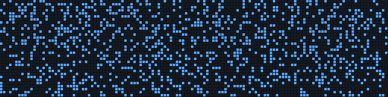

  

<h2 align="center">Hi, I'm Abdelghafour Titi</h2>

  Engineering student at <b>ENSIAS</b> (Rabat, Morocco), after two years of <b>CPGE MP</b>. 
  I like math more than code, so I write the kind of code where the math matters: 
  rendering, algorithms, and systems that have to be fast.

  
  
  
  

---

### Things I've built

| Project | What it is |
|---|---|
| [**titirenderer**](https://github.com/titiabdelghafour8-lab/titirenderer) | A software rasterizer written from scratch in C++23: my own math library, clip-space clipping, a z-buffer. No graphics API, just pixels. |
| [**gamedev-journey**](https://github.com/titiabdelghafour8-lab/gamedev-journey) | Notes and projects from learning game development, from low-level C++ up to Godot. |
| [**neetcode-submissions**](https://github.com/titiabdelghafour8-lab/neetcode-submissions) | About 120 NeetCode problems solved: arrays, graphs, DP, and the rest. |
| [**simulation-de-vote-multi-agents**](https://github.com/titiabdelghafour8-lab/simulation-de-vote-multi-agents) | A multi-agent simulation of voting systems. |

### What I'm working on next

- **A parallel graph engine in C++**: CSR storage, BFS, PageRank, connected components, triangle counting, with benchmarks.
- **A vector + graph retrieval engine**: my own HNSW index, and an evaluation of GraphRAG against plain vector search.
- **A small database**: a SQLite-like engine, then a rewrite in modern C++ with a real parser, a buffer pool and a WAL.
- **ML foundations**: learning theory and the systems side of ML.

### Interests

Systems for ML · algorithms · computer graphics · mathematics

---

The banner is Conway's Game of Life, drawn by <a href="scripts/life.py">scripts/life.py</a>. A GitHub Action draws a new board from a new seed every week.
